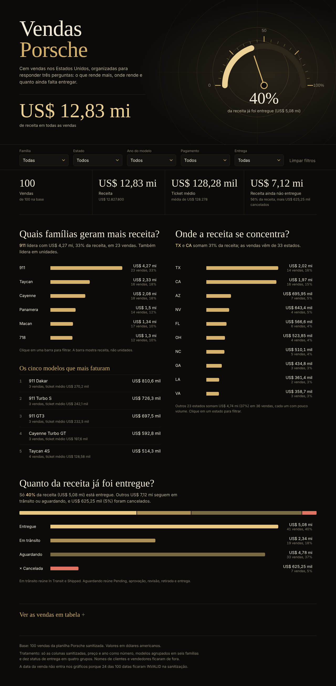
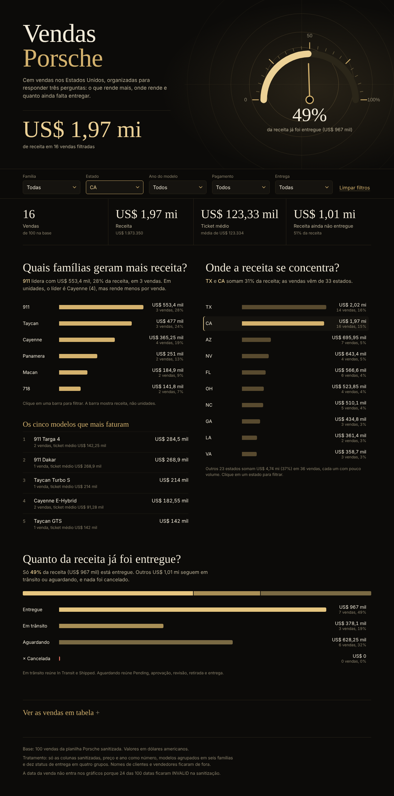
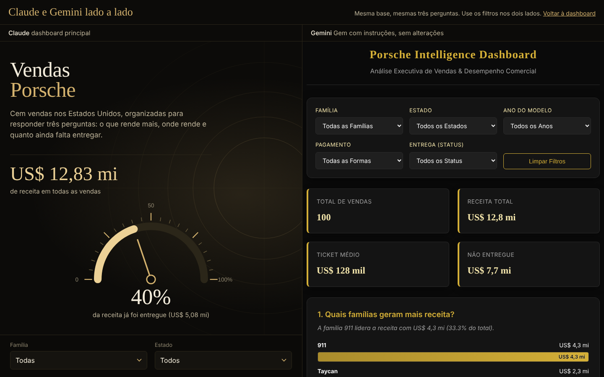

# Dashboard de vendas Porsche

Dashboard interativa em um único arquivo HTML, feita a partir de uma planilha com 100 vendas da Porsche. Responde três perguntas de negócio, tem cinco filtros e indicadores de topo, e usa uma identidade preta e dourada.

**Endereço da dashboard:** https://SEU-USUARIO.github.io/dashboard-vendas-porsche/

## Perguntas de negócio

1. **Quais famílias geram mais receita?**
   O 911 tem 23 vendas e responde por 33% da receita. Olhar só a quantidade de carros esconderia isso, porque um 911 vale muito mais que um Macan. O gráfico mede dinheiro, não unidades.
2. **Onde a receita se concentra?**
   Texas e Califórnia somam 31% da receita, e as vendas vêm de 33 estados. Escolhi estado e não cidade porque a base tem 79 cidades para 100 vendas, quase todas com uma ou duas, o que tornaria o filtro inútil.
3. **Quanto da receita já foi entregue?**
   Só 40% da receita (US$ 5,1 mi) está em carros entregues. US$ 7,1 mi estão em trânsito ou aguardando e US$ 625 mil foram cancelados. É a pergunta que leva a uma ação: o que está parado e por quê.

Eu tinha pensado em uma pergunta sobre método de pagamento, mas troquei pela das entregas, que mostra um risco do negócio e não só uma distribuição.

## Visual

Identidade preta e dourada, com tipografia serifada nos títulos e números (Cormorant Garamond) e sem serifa no texto (Jost). No topo há um medidor no estilo de velocímetro que mostra a parcela da receita já entregue e acompanha os filtros, e ao lado do gráfico de famílias fica a lista dos cinco modelos que mais faturam.

Para ter uma foto de fundo no topo, coloque um arquivo `hero.jpg` na pasta `imagens/`. Sem o arquivo, a dashboard funciona igual, só sem a foto. Use apenas imagens que você tenha direito de publicar.

## Filtros

Família, estado, ano do modelo, método de pagamento e situação da entrega. Todos se combinam e atualizam os indicadores, os gráficos e a tabela. Clicar em uma barra também aplica o filtro, e cada gráfico mantém visíveis as outras barras da sua própria dimensão para não perder o contexto.

Exemplo: com o estado **CA** aplicado, a dashboard mostra 16 vendas, US$ 1,97 mi de receita, e o 911 aparece como líder com 28% (US$ 553 mil).

## Tratamento da base

Feito em `tratar_base.py`, que gera `base_tratada.csv` (a mesma tabela embutida no `index.html`):

- Fiquei só com as colunas sanitizadas e converti preço, ano e quilometragem para número.
- **Removi `customer_name` e `salesperson`.** São dados pessoais e a base vai embutida em uma página pública.
- Criei a coluna `familia`: os 40 modelos viraram 911, 718, Cayenne, Macan, Taycan e Panamera.
- Agrupei os 10 status de entrega em 4 grupos: Entregue; Em trânsito (In Transit, Shipped); Aguardando (Pending, Pending Approval, Pending Review, Awaiting Review, Awaiting Delivery, Awaiting Pickup); Cancelada.
- Não usei a data da venda: 24 das 100 datas ficaram `INVALID` na sanitização, e as válidas chegam a 2027. Um gráfico por mês deixaria um quarto das vendas de fora.
- Conferências no script: nenhum valor vazio, nenhum modelo sem família, ids únicos.

## Ferramenta e prompt

Fiz os dois caminhos: a dashboard principal foi gerada com o **Claude**, e a versão para comparação foi gerada por um **Gem do Gemini** (instruções fixas, que fazem o papel da skill, mais o `base_tratada.csv` anexado). As instruções do Gem e o prompt estão em [`comparacao/gem-instrucoes.md`](comparacao/gem-instrucoes.md). Não usei ChatGPT, que exige a versão paga.

Prompt da versão final, resumido:

> Tenho uma planilha com 100 vendas da Porsche (modelo, ano, preço, método de pagamento, cidade, estado e status de entrega, todos já sanitizados). Monte uma dashboard em HTML de arquivo único, sem bibliotecas externas, que responda três perguntas: quais famílias de modelo geram mais receita, onde a receita se concentra por estado e quanto da receita já foi entregue. Inclua indicadores de topo (vendas, receita, ticket médio, receita ainda não entregue), filtros de família, estado, ano do modelo, pagamento e entrega, e uma tabela das vendas filtradas. Identidade visual preta e dourada, elegante, inspirada na Porsche. Não inclua nomes de clientes nem de vendedores.

O que mudou até a versão final:

- A terceira pergunta era sobre método de pagamento e passou a ser sobre entregas.
- Cidade foi trocada por estado no filtro, pelo motivo acima.
- As barras não apareciam na primeira versão (erro de CSS); corrigi e conferi no navegador.
- O gráfico de estados tinha uma barra "Outros" que dominava a tela. Troquei por dez barras e uma nota com o total dos demais estados, e corrigi os percentuais para serem sobre o total filtrado.
- Ajustei as cores dos grupos de entrega (dourado em três tons mais um vermelho suave para cancelada) até todas terem contraste suficiente com o fundo e cada barra ter também o nome ao lado.
- Os valores passaram a mostrar duas casas decimais (US$ 2,02 mi em vez de US$ 2 mi).
- Na segunda rodada pedi uma versão mais profissional: entrou o medidor de entregas, os arcos dourados no topo, a lista dos cinco modelos que mais faturam e o espaço opcional para uma foto.

## Comparação: Claude e Gemini

As duas versões estão lado a lado em `comparacao/lado-a-lado.html` (no GitHub Pages: `.../comparacao/lado-a-lado.html`). A versão do Gemini está salva sem alterações em `comparacao/gemini.html`, e `comparacao/claude.html` é uma cópia da dashboard principal para a página funcionar sozinha.

A base embutida e os indicadores principais foram iguais nos dois (100 vendas, US$ 12,8 mi, 40% entregue; no filtro 911 em CA, 3 vendas e US$ 553 mil nos dois). A diferença esteve nas decisões de análise e de leitura:

- O Gemini contou vendas canceladas como "receita não entregue" (US$ 7,7 mi). Na versão do Claude, as canceladas ficam separadas (US$ 7,1 mi pendentes e US$ 625 mil cancelados), porque cancelada não vai mais ser entregue.
- O Gemini mostrou só 5 dos 33 estados, sem avisar, e o texto citava apenas o líder (TX, 15,8%). A outra versão mostra 10, informa quanto os demais somam e destaca que TX e CA juntos têm 31%.
- O Gemini repetiu o valor dentro e fora de cada barra, com pouco contraste dentro, e escreveu percentuais com ponto (33.3%).
- O Gemini deixou a tabela de 100 linhas sempre aberta; a outra versão a recolhe.

Aprendizado: a ferramenta acerta a parte mecânica (somar, filtrar), mas definições de negócio como "não entregue" precisam ser conferidas por mim.

## Arquivos

- `index.html`: a dashboard (dados embutidos).
- `base_tratada.csv`: a base depois do tratamento.
- `tratar_base.py`: o script do tratamento (`python tratar_base.py planilha.xlsx`).
- `prints/`: capturas da dashboard, de um filtro aplicado e da comparação.
- `imagens/`: pasta para a foto opcional do topo (`hero.jpg`).
- `comparacao/`: a página lado a lado (`lado-a-lado.html`), a versão do Gemini (`gemini.html`), a cópia da dashboard do Claude (`claude.html`) e as instruções do Gem (`gem-instrucoes.md`).

## Publicar

Em Settings > Pages do repositório, escolha a branch `main` e a pasta raiz. A dashboard abre em `https://SEU-USUARIO.github.io/dashboard-vendas-porsche/`.
